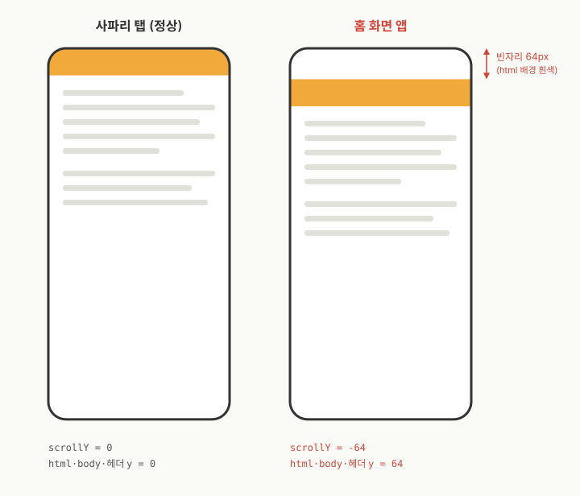

헤더 탭바가 있어서 모바일 앱처럼 보이는 웹사이트를 Vite + React 기반 PWA 으로 만들었는데, 아이폰 `홈 화면에 추가`로 설치를 해서 열면 화면 위쪽에 뿌연 흰 띠가 생기는 거예요. 사파리로 열면 멀쩡한데 말이죠.

<!-- truncate -->

버전을 다섯 번 올리는 동안 못 잡았습니다. 결론부터 말하면 블러도, 메타 태그도 아니었고, 문서 전체가 64px 아래로 밀려 있었던 겁니다.

## 증상

구조는 단순합니다. 위에는 앰버색 헤더가 `position: fixed` 로 붙어 있고, 아래에는 탭바가 역시 fixed 로 붙어 있고, 본문만 안쪽 스크롤러에서 스크롤되는 구조였습니다.

- 아이폰 사파리 탭에서 열면 정상.
- 홈 화면에 추가한 앱으로 열면 상단에 반투명한 흰 그라데이션 띠가 대략 100px.
- 이걸 위해 스크롤을 밀고, 땡기고 했는데 잡히지가 않음.

기기는 iOS 27.0.1, 375×812 짜리 아이폰이었습니다. 데스크톱 사파리에서도, 시뮬레이터에서도 재현이 안 됐어요. 이게 제일 골치였죠. 시뮬레이터에서도 재현이 안 되다니. (부들부들)

## 잘못 짚은 길 1: Liquid Glass

처음엔 당연히 iOS 26 부터 들어온 `리퀴드 글래스(Liquid Glass)` 를 의심했습니다. 화면 가장자리에 고정 요소가 있으면 시스템이 그 색을 읽어서 블러를 깔아 준다는 그 기능이요. 에이전트가 자꾸 뿌연 그라데이션이 그거라고 추정을 하는 거예요.

진짜인가 싶어서 WebKit 소스의 `LocalFrameView::fixedContainerEdges` 까지 읽었습니다. fixed 나 sticky 요소여야 하고, 뷰포트 너비의 90% 이상을 덮어야 하고, 상단 4px 지점에서 히트 테스트를 하고, 두께가 10px 이하면 무시한다(...)는 조건까지 확인했어요. 그래서 조건에 딱 맞게 상단에 불투명한 앰버색 고정 띠를 하나 깔았습니다.

하지만 실패.

## 잘못 짚은 길 2: status-bar-style 메타

다음 용의자는 `apple-mobile-web-app-status-bar-style=black-translucent` 였습니다. 상태표시줄을 투명하게 만들고 웹 콘텐츠를 그 밑까지 끌어올리는 메타라, 여기서 뭔가 어긋났겠거니 했죠.

이 메타는 홈 화면에 추가하는 순간에만 읽힙니다. 그래서 바꿀 때마다 앱을 지우고 다시 설치해야 해요. 지우고, 다시 설치하고, 열어 봤습니다.

역시 실패.

다만 이 제거는 그냥 두기로 했어요. 상태표시줄이 `theme-color` 로 불투명하게 칠해져서 오히려 보기 좋았거든요.

## 잘못 짚은 길 3: 스크롤 막기

그래서 html 과 body 에 `overflow: hidden`, body 에 `position: fixed; inset: 0`, 거기에 `overscroll-behavior: none` 까지 넣어 봤습니다. 본문 여백 문제는 좀 나아졌는데, 띠는 그대로.

세 번째 가설까지 틀리고 나니까 그제서야 깨달았죠. 지금 나는 화면을 눈으로만 보고 있다는 걸.

## 실기기에서 숫자 뽑기

증상 발현이 실기기에서만 되니, 실기기에서 숫자를 확인해봐야했습니다.

개발 서버에 임시 진단용 Vite 플러그인을 하나 넣었어요. `apply: 'serve'` 라 배포 빌드에는 안 들어가는 방식입니다. 페이지가 `pageshow`, `resize`, `click` 때마다 주요 요소의 `getBoundingClientRect()`, `window.scrollY`, `visualViewport` 값을 모아서 개발 서버의 `/__layout-diagnostics` 로 POST 하는 방식이죠.

그리고 아이폰으로 개발 서버 쪽으로 접근. 찍혀 나온 숫자는 이랬습니다.

- 홈 화면 앱에서만 `window.scrollY` 와 `visualViewport.offsetTop` 이 둘 다 -64.
- html, body, 고정 헤더의 `getBoundingClientRect().y` 가 전부 64.
- 하단 탭바의 아래 끝은 832. 화면 높이 768 을 넘어서 잘려 있음.
- `black-translucent` 로 설치했을 때는 -108. 상태표시줄 44 에 64 를 더한 값.
- 사파리 탭에서는 언제나 0.


오히려 저 상단 값을 강제로 잡느라 오히려 하단의 탭바가 올라가서, 문제가 더 복잡하게 느껴졌습니다.

그 "그라데이션"의 정체는 블러가 아니었습니다. 문서 전체가 64px 아래로 밀려 있었고, 그렇게 생긴 빈자리로 html 배경색(흰색)이 비쳐 보였던 거죠. 그라디언트, 블러가 아니었던 겁니다. 위에 깔린 시스템 블러와 섞여서 그라데이션처럼 보였을 뿐.

## 원인: phantom scroll

iOS 26/27 의 홈 화면 웹앱은 실행될 때 웹뷰를 상태표시줄 아래로 다시 프레이밍하는데, 그러면서 문서를 음수 스크롤 위치에 둔 채로 내버려 두는 경우가 있습니다. 이걸 `phantom scroll` 이라고 부르더군요. 스크롤이 막혀 있든 말든 상관없이 일어나서, `overflow: hidden` 이나 body 고정으로는 안 막힙니다.

증상 키워드로 검색해 보니 같은 달에 같은 걸 겪고 고친 프로젝트가 있었습니다. [`victronenergy/gui-v2`](https://github.com/victronenergy/gui-v2) 의 [PR #3280](https://github.com/victronenergy/gui-v2/pull/3280) 인데, iOS 27 에서 가로에서 세로로 돌리면 웹뷰가 다시 프레이밍되면서 문서가 상태표시줄 높이만큼 밀린 채 남는다는 내용이었어요. 해법은 그 시그니처를 감지해서 `window.scrollTo(0, 0)` 으로 되돌리는 것. 재프레이밍이 몇 프레임에 걸쳐 끝나니 잠깐 뒤에 한 번 더 확인하고요.

## 고친 코드

스무 줄 남짓입니다.

```ts
export function startStandaloneViewportReset() {
  if (!matchMedia('(display-mode: standalone)').matches) return;
  const reset = () => {
    if (window.scrollY < 0 || document.body.getBoundingClientRect().top > 0) window.scrollTo(0, 0);
  };
  let timers: number[] = [];
  const schedule = () => {
    timers.forEach(clearTimeout);
    timers = [150, 600].map(ms => window.setTimeout(reset, ms));
    reset();
  };
  for (const type of ['pageshow', 'resize', 'orientationchange', 'focus']) window.addEventListener(type, schedule);
  document.addEventListener('visibilitychange', schedule);
  window.visualViewport?.addEventListener('resize', schedule);
  schedule();
}
```

하나 조심한 건 키보드입니다. 입력란을 누르면 iOS 가 페이지를 위로 밀어 올려서(body top < 0) 입력란이 보이게 하는데, 그건 정상 동작이라 건드리면 안 됩니다. 그래서 아래로 밀린 경우, 즉 `scrollY < 0` 이거나 body top 이 0 보다 클 때만 되돌립니다.

적용하고 아이폰에서 앱을 다시 열자 진단값이 `scrollY` 0, html y 0, 탭바 아래 끝 768(= `innerHeight`)로 돌아왔습니다. 띠도 사라졌고요.

## 배운 것

- 브라우저에선 안 보이고 설치한 앱에서만 보이는 문제는, 추측으로 CSS 를 고치지 말고 실기기에서 숫자부터 뽑자. 개발 서버에 POST 받는 엔드포인트 하나면 충분하더라.
- 그럴듯한 가설이 두 번 연속 틀렸다. WebKit 소스를 읽으면 뭐하나, 엉뚱한 걸 읽으면 헛수고. 측정값 하나로 가설 세 개를 바로 정리.
- 검색은 여전히 미묘한 영역. "상단 흰 띠" 등의 내용으로는 안 나오던 게 "문서가 상태표시줄 높이만큼 밀림"으로는 나옴. 하지만 이것도 그 부분만 해결하려고 강제로 끌어올리면 엉뚱하게 탭바가 올라가고.

## 관련 링크

- [victronenergy/gui-v2 PR #3280](https://github.com/victronenergy/gui-v2/pull/3280)
- [WebKit LocalFrameView.cpp (fixedContainerEdges)](https://github.com/WebKit/WebKit/blob/main/Source/WebCore/page/LocalFrameView.cpp)
- [WebKit bug 297779: iOS 26 에서 fixed 요소가 이동하는 문제](https://bugs.webkit.org/show_bug.cgi?id=297779)
